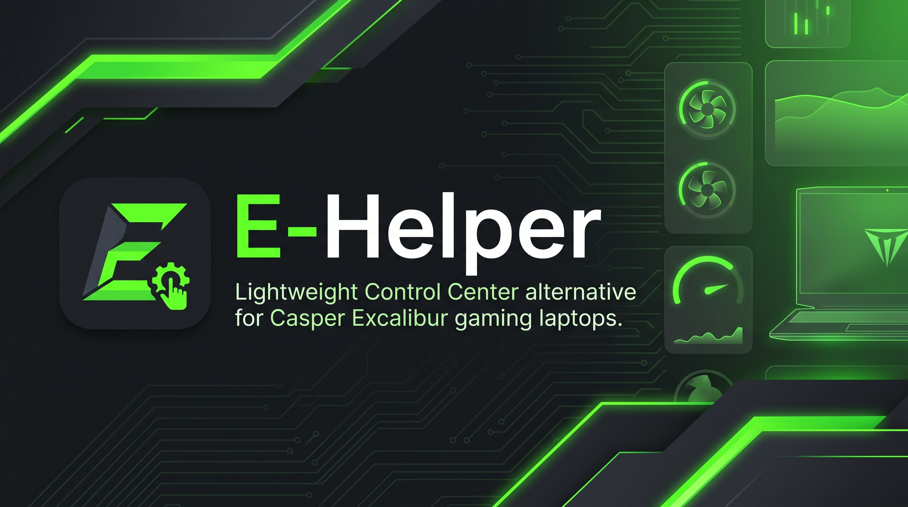

<p align="center">
  
</p>

# E-Helper — Casper Excalibur Control Center

<p align="center">
  <a href="https://github.com/berkevnl/E-Helper/releases"></a>
  <a href="https://github.com/berkevnl/E-Helper/releases/latest/download/E-Helper.exe"></a>
  <a href="https://github.com/berkevnl/E-Helper/blob/main/LICENSE"></a>
  <a href="#-why-e-helper-key-advantages"></a>
  <a href="https://dotnet.microsoft.com/download/dotnet/8.0"></a>
  <a href="README.tr.md"></a>
</p>

---

**E-Helper** is an ultra-lightweight, dedicated open-source hardware control center engineered specifically for **Casper Excalibur** gaming laptops. It replaces heavy, unstable, and bloated OEM vendor software (*Excalibur Control Center*) with a single, standalone, zero-bloat portable executable.

Inspired by the acclaimed **G-Helper** philosophy, E-Helper interfaces directly with the laptop's Embedded Controller (EC) and ACPI/WMI subsystem, delivering an instantaneous, responsive flyout control panel with zero background services and zero telemetry.

<p align="center">
  <a href="https://github.com/berkevnl/E-Helper/releases/latest/download/E-Helper.exe">
    
  </a>
  <br>
  <sub><i>Single-file portable binary — No installation required. Visit <a href="https://github.com/berkevnl/E-Helper/releases/latest">Releases</a> for complete changelogs and standalone ZIP packages.</i></sub>
</p>

---

## 📊 OEM Control Center vs. E-Helper

| Feature / Metric | Official OEM Control Center | E-Helper (v1.2.0) |
| :--- | :---: | :---: |
| **RAM Usage (Idle / Tray)** | 200 MB – 450 MB | **~1 MB – 5 MB** |
| **RAM Usage (Active Window)** | 350 MB – 600 MB | **~15 MB – 30 MB** (Auto-trimmed) |
| **Background Services & Daemons** | 4 – 8 persistent background services | **0 (Zero background services)** |
| **Telemetry & Analytics Tracking** | Continuous telemetry collection | **0 (Strictly local, no tracking)** |
| **UI Launch Latency** | 3 – 8 seconds (heavy web/hybrid framework) | **Instant (< 100 ms flyout)** |
| **Installation Requirement** | Multi-step installer, registry bloat | **Single portable `.exe` (Zero install)** |
| **Reboot Settings Persistence** | Frequently resets lighting/fans | **100% resilient post-boot sync** |
| **Hardware Communication** | Heavy middleman service layers | **Direct ACPI WMI SMI & NVIDIA NVML** |
| **Keyboard Lighting Control** | Basic OEM modes | **3-Zone Custom, Cycle (70 FPS), Wave, Speed Bar** |
| **Auto-Updater** | Clunky manual downloads | **Seamless 1-click self-update & restart** |

---

## ⚡ Why E-Helper? (Key Advantages)

1. **Dedicated Excalibur Architecture:** Engineered specifically for Casper Excalibur gaming laptop motherboards and Quanta EC registers.
2. **Microscopic Resource Footprint:** Idles in the System Tray consuming merely **~1 – 5 MB RAM**. When active on screen, working memory is kept strictly around **~15 – 30 MB** via automated working-set trimming.
3. **Pure Zero-Bloat Execution:** No background helper daemons, no telemetry beacons, no analytics agents, and no unnecessary services wasting CPU cycles.
4. **Permanent Settings Persistence:** Power profiles, keyboard lighting modes, brightness, and custom zone colors automatically survive Windows restarts and cold boots through elevated task scheduling and delayed post-boot EC re-synchronization.
5. **Direct Hardware Bridge:** Directly communicates with the motherboard Embedded Controller (`0xFA00` Read / `0xFB00` Write SMI) and NVIDIA NVML, completely bypassing bloated vendor background services.
6. **Instant-Access System Tray Flyout:** Docks discreetly in the Windows Notification Area. A single click displays an elegant, high-DPI flyout that can also be freely moved across screens.
7. **Bilingual & Dual Theme:** Seamlessly switch between Turkish and English, plus authentic Matte Dark and Clean Light themes with zero restart required.

---

## 🎯 Features & Capabilities

### 1. ⚡ Power & Performance Profiles
* **Eco (Office / Tasarruf):** Reduced fan RPM, quiet acoustics, energy-efficient power envelope.
* **Balanced (Gaming / Dengeli):** Dynamic fan curves and calibrated thermals for everyday gaming.
* **Performance (Turbo / Performans):** Maximum fan airflow, expanded thermal headroom, and peak sustained GPU/CPU clock frequencies.
* *Directly synchronized with native Windows power schemes (`PowerSetActiveScheme`).*

### 2. 📊 Real-Time Hardware Telemetry
* **Thermal & Fan Metrics:** Accurate real-time CPU die temperature (°C) and tachometer fan speeds (RPM).
* **Authoritative GPU Telemetry:** Reads true die thermals and fan RPM directly from the dedicated GPU via **NVIDIA NVML**, bypassing inaccurate or hardcoded EC dummy registers.
* **System Resource Monitor:** Real-time RAM allocation (used / total GB and percentage) and primary SSD (C:) storage utilization.
* **Live System Tray Tooltip:** Hovering over the tray icon reveals current CPU/GPU temperatures and fan speeds without opening the window.

### 3. 🌈 Keyboard RGB Lighting Engine
* **6 Lighting Modes:**
  * **Sabit (Static):** Single static color across the entire keyboard.
  * **Nefes (Breathing):** Hardware-native smooth pulsing with natural fade to complete darkness and gentle return.
  * **Dinamik (Colorful Dynamic Cycle):** Continuous hardware dynamic color shifting.
  * **Döngü (Synchronized Spectrum Cycle):** High-refresh (~70 FPS) synchronized spectrum flow where all keys smoothly traverse the 360° RGB spectrum in unison without discrete stepping or flickering.
  * **Gökkuşağı (Rainbow Wave):** Multi-zone spectrum wave flowing naturally from left to right (WASD → Center → Numpad).
  * **3-Bölge (3-Zone Custom RGB):** Independent color assignment for each physical keyboard zone.
* **Interactive 2D 3-Zone Schematic:** Bird's-eye schematic providing direct, visual color assignment to Left (WASD), Center, and Right (Numpad) zones.
* **Dynamic 3-Tier Speed Slider:** Seamlessly adjust animation speed (**Slow**, **Medium**, **Fast**) for Cycle and Rainbow modes, with real-time status indicated in the header (`Brightness: 100% - Fast`).
* **Windows 11 Style Color Picker:** 2D HSV color canvas, 1D hue slider, Hex code input, RGB fine-tuning, and curated preset swatches.
* **Hardware Brightness Steps:**
  * `0` : **Off (0%)** — Shuts down all keyboard LED power planes.
  * `1` : **50% Brightness** — Balanced ambient illumination.
  * `2` : **100% Brightness** — Full maximum illumination.
  * *Supports direct click-to-position on the slider bar.*
* **Cold-Boot Resilience:** Preserves lighting mode, brightness, speed, and zone colors across reboots.

### 4. 🎨 UI & Visual Ergonomics
* **Modern Typography:** Integrated Google Sans and modern system typography with ClearType and Display subpixel rendering modes for razor-sharp text.
* **100% Vector Iconography:** Crisp vector geometries across all section headers, cards, and buttons with no clipping or scaling artifacts.
* **One-Click Theme Switch:** Toggle between authentic G-Helper Matte Dark and Clean High-Contrast Light mode.
* **Soft Micro-Interactions:** Fluid, subtle hover transitions and non-blocking flyout animations.

### 5. 🔄 Seamless In-App Auto-Updater
* **Silent Background Check:** Checks GitHub Releases silently on startup with zero impact on launch speed (0 ms delay).
* **Interactive Indicator:** Displays status in the bottom-left corner (`Version: 1.2.0` when up to date, red `Download: 1.1.1 → 1.2.0` when an update is available).
* **One-Click Self-Update:** Downloads the latest release package in the background, cleanly terminates the running app, replaces the binary, and immediately restarts the updated version.

---

## 💻 Hardware Compatibility

E-Helper is built specifically for the **Casper Excalibur** laptop platform:

### ✅ Verified On Physical Hardware
> Tested and confirmed working (power modes, telemetry, fan readouts, and RGB keyboard control):
* **Excalibur G770** (Tested & Verified)
* **Excalibur G850 / G860** (Tested & Verified)
* **Excalibur G870** (Tested & Verified)
* **Excalibur G911** (Tested & Verified)

### 🔍 Architecture Compatibility
Compatible across Casper Excalibur laptops utilizing Quanta ACPI/WMI Embedded Controller platforms:
* **Excalibur G780**
* **Excalibur G900**
* **Excalibur G920**

---

## 🔬 How It Works (Under the Hood)

```
┌────────────────────────────────────────────────────────┐
│                   E-Helper (WPF / .NET 8)              │
│       Flyout UI  •  System Tray  •  Config Manager     │
└───────────┬────────────────────────────────┬───────────┘
            │                                │
            ▼ (ACPI WMI SMI)                 ▼ (NVIDIA NVML)
┌────────────────────────┐      ┌────────────────────────┐
│  Casper / Quanta EC    │      │  NVIDIA Dedicated GPU  │
│  - Power Profiles      │      │  - True Die Temp       │
│  - Fan Tachometer      │      │  - Dedicated Fan RPM   │
│  - RGB Keyboard Zones  │      └────────────────────────┘
└────────────────────────┘
```

1. **WMI ACPI SMI Bridge:** Communicates with the hardware embedded controller through the root ACPI WMI namespace (`ROOT\WMI`). Commands are packaged into standardized `SMI_STRUCT_S` structures:
   * `0xFA00`: Command Read (telemetry and fan RPM)
   * `0xFB00`: Command Write (power profiles, fan speed overrides, and LED controls)
   * Subfunctions: `0x0100` (LED), `0x0200` (CPU/GPU), `0x0205` (Fan Speed), `0x0300` (Power Mode).
2. **NVML Direct Interop:** Connects directly to `nvml.dll` to read authentic thermal sensors from NVIDIA GeForce RTX/GTX GPUs, bypassing uncalibrated EC ADC registers.
3. **Elevated Startup Task:** Creates an elevated Windows Task Scheduler task (`HighestAvailable` privilege) to allow silent startup on Windows logon without triggering UAC elevation popups.

---

## 🚀 Download & Installation

1. Navigate to the [Releases](https://github.com/berkevnl/E-Helper/releases/latest) page.
2. Download **`E-Helper.exe`** (standalone portable binary, ~156 MB, includes embedded .NET runtime) or **`E-Helper-v1.2.0-win-x64.zip`**.
3. Right-click `E-Helper.exe` and select **Run as Administrator** *(Administrator privileges are required by Windows to access ACPI WMI hardware interfaces)*.
4. E-Helper will dock into your **System Tray** (near the clock). Click the tray icon to toggle your control panel!
5. *(Optional)* Check **Start with Windows** inside the app to enable seamless background startup.

---

## 🛠️ Building from Source

### Prerequisites
* Windows 10 / 11 (64-bit)
* [.NET 8.0 SDK](https://dotnet.microsoft.com/download/dotnet/8.0) or later
* Visual Studio 2022 (with *.NET Desktop Development* workload) or VS Code / JetBrains Rider

### Build Steps
```powershell
# Clone the repository
git clone https://github.com/berkevnl/e-helper.git
cd e-helper

# Restore dependencies and build
dotnet build src/EHelper/EHelper.csproj -c Release

# Or generate self-contained standalone binaries and signed packages
powershell -ExecutionPolicy Bypass -File scripts/build-and-sign.ps1
```

The compiled standalone executable will be located in `publish-standalone\E-Helper.exe`.

---

## 💖 Acknowledgments & Philosophy

This project is deeply inspired by **[G-Helper](https://github.com/seerge/g-helper)** created by **[Seerge](https://github.com/seerge)**. E-Helper aims to deliver that same lightweight, clean, and respectful computing experience directly to Casper Excalibur users.

---

## ⚖️ Trademarks & Legal Disclaimer

* All product names, logos, and brands (including *Casper*, *Excalibur*, *Windows*, and *NVIDIA*) are property of their respective owners and are used solely for identification and hardware compatibility purposes.
* **E-Helper** is an independent, community-driven open-source project and is not affiliated with, endorsed by, or associated with Casper Bilgisayar Sistemleri A.Ş.
* This software is distributed under the **GNU General Public License v3.0 (GPL-3.0)** in the hope that it will be useful, but WITHOUT ANY WARRANTY of any kind.
