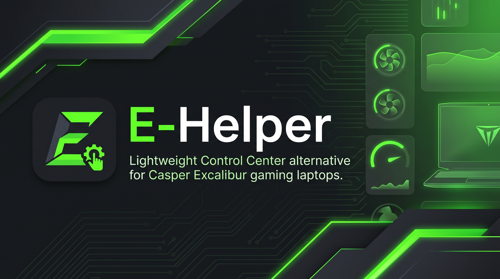

<p align="center">
  
</p>

<h1 align="center">E-Helper</h1>

<p align="center">
  <b>A lightweight, open-source control center for Casper Excalibur gaming laptops.</b><br>
  Power modes, live telemetry, RGB keyboard lighting and per-app profiles in a single portable executable.
</p>

<p align="center">
  <a href="https://github.com/berkevnl/E-Helper/releases/latest"></a>
  <a href="https://github.com/berkevnl/E-Helper/releases"></a>
  <a href="https://dotnet.microsoft.com/download/dotnet/8.0"></a>
  
  <a href="LICENSE"></a>
</p>

<p align="center">
  <a href="README.tr.md">Türkçe</a> ·
  <a href="https://github.com/berkevnl/E-Helper/releases/latest">Download</a> ·
  <a href="#features">Features</a> ·
  <a href="#compatibility">Compatibility</a> ·
  <a href="#building-from-source">Build</a>
</p>

---

## Overview

**E-Helper** replaces the vendor *Excalibur Control Center* with a small, fast and privacy-respecting utility. It talks directly to the laptop's Embedded Controller (EC) through ACPI WMI and reads NVIDIA GPU data through NVML. There are no background services, no telemetry and nothing to install.

Inspired by [G-Helper](https://github.com/seerge/g-helper), E-Helper lives in the system tray and opens a compact flyout panel with a single click.

<p align="center">
  <a href="https://github.com/berkevnl/E-Helper/releases/latest">
    
  </a>
  <br>
  <sub>Portable: extract and run. No installer and no separate .NET runtime required.</sub>
</p>

## Highlights

| | Vendor Control Center | E-Helper |
| :--- | :--- | :--- |
| **Memory use** | Several hundred MB | ~5–10 MB in tray · ~30–50 MB with panel open |
| **Background services** | Multiple resident services | None |
| **Telemetry / analytics** | Enabled | None, fully local |
| **Installation** | Installer + drivers | Single portable executable |
| **Panel open time** | Seconds | Instant |
| **Settings after reboot** | May reset | Re-applied automatically after logon |
| **Updates** | Manual download | One-click in-app update |

## Features

### Power modes
- **Eco**, **Balanced** and **Performance** profiles written directly to the EC.
- Each mode also switches the matching Windows power plan (Power saver / Balanced / High performance).

### Live telemetry
- CPU and GPU temperature, fan speed (RPM) and usage.
- NVIDIA GPU temperature read from the driver via **NVML**, which is more accurate than the EC sensor.
- RAM and system drive (C:) usage.
- Tray icon tooltip shows CPU/GPU temperature and fan speed without opening the panel.

### RGB keyboard lighting
| Mode | Description |
| :--- | :--- |
| **Static** | One color across the whole keyboard |
| **Breathing** | Hardware breathing effect |
| **Dynamic** | Hardware color cycle |
| **Spectrum** | Smooth, synchronized full-spectrum cycle |
| **Rainbow** | Rainbow wave flowing left → right |
| **3-Zone** | Independent color for left, center and right zones |

- Brightness: **Off / 50% / 100%**.
- Animation speed for Spectrum and Rainbow: **Slow / Medium / Fast**.
- Color picker with HSV canvas, HEX input and quick swatches; the keyboard previews the color live.
- **Sleep timer:** turns the backlight off after 15 s, 30 s, 45 s, 60 s or 5 min of inactivity and restores it on the next keyboard, mouse or touchpad input.

### Application profiles
- Bind a power mode + lighting setup to any game or application (`.exe`).
- The profile is applied automatically when the application is in use and your own settings are restored when it closes.
- Pick the app from the list of running processes or browse for the executable.

### Interface
- Dark and light themes, plus 8 accent colors.
- Turkish and English, switchable instantly without restart.
- Optional start with Windows through Task Scheduler (no UAC prompt at logon).
- Automatic update check on startup; one click downloads, replaces and restarts the app.

## Compatibility

E-Helper targets **Casper Excalibur** laptops that use the Quanta ACPI/WMI EC interface.

**Verified on hardware:** G770 · G850 / G860 · G870 · G911

**Expected to work (same EC interface):** G780 · G900 · G920

> [!NOTE]
> On unsupported machines E-Helper starts in **simulation mode** and does not send any commands to the hardware.

**Requirements:** Windows 10 or 11 (64-bit), administrator rights (required by Windows for ACPI WMI access). An NVIDIA GPU is optional; it is used for GPU temperature and usage readings.

## Getting started

1. Download `E-Helper-vX.Y.Z-win-x64.zip` from the **[latest release](https://github.com/berkevnl/E-Helper/releases/latest)**.
2. Extract it to a permanent folder, for example `C:\Tools\E-Helper`.
3. Run `E-Helper.exe` as administrator.
4. E-Helper appears in the system tray next to the clock. Click the icon to open the panel.
5. Optionally enable **Start with Windows** in **Settings**.

Settings are stored in `%LOCALAPPDATA%\E-Helper\config.json`.

> [!TIP]
> The release also contains the uncompressed `E-Helper.exe` (~156 MB). The ZIP package (~64 MB) contains the same self-contained application and downloads faster.

## How it works

```
┌──────────────────────────────────────────────────────────────┐
│                 E-Helper  (WPF · .NET 8)                     │
│   Tray flyout · Settings · Profile watcher · Auto-updater    │
└───────────────┬───────────────────────────────┬──────────────┘
                │ ACPI WMI (root\WMI)           │ NVML
                ▼                               ▼
     ┌──────────────────────┐        ┌──────────────────────┐
     │  Casper / Quanta EC  │        │  NVIDIA GPU driver   │
     │  power · fans · RGB  │        │  temp · fan · usage  │
     └──────────────────────┘        └──────────────────────┘
```

- **EC bridge:** commands are sent as `SMI_STRUCT_S` packets through the `RW_GMWMI` WMI class.
  - `0xFA00` read · `0xFB00` write
  - Sub-functions: `0x0100` LED · `0x0200` CPU/GPU telemetry · `0x0205` fan speed · `0x0206` fan override · `0x0300` power mode
- **NVML:** `nvml.dll` is loaded at runtime. If no NVIDIA driver is present, GPU readings are simply skipped.
- **Startup:** a scheduled task with `HighestAvailable` run level starts E-Helper at logon; saved settings are re-applied shortly afterwards because the EC can reset its state during boot.
- **Memory:** the working set is trimmed when the panel is hidden, keeping the tray footprint small.
- **Privacy:** the only network request is the update check against the GitHub Releases API.

## Building from source

**Prerequisites:** Windows 10/11 x64, [.NET 8 SDK](https://dotnet.microsoft.com/download/dotnet/8.0) or newer.

```powershell
git clone https://github.com/berkevnl/E-Helper.git
cd E-Helper

# Release build
dotnet build src/EHelper/EHelper.csproj -c Release

# Self-contained single-file build + release ZIP (output: publish-standalone\)
powershell -ExecutionPolicy Bypass -File scripts/build-and-sign.ps1 -SkipSign
```

The application version is defined once in `src/EHelper/EHelper.csproj`.

### Project structure

```
src/EHelper/
├── Core/          Domain types: power/LED enums, IHardwareProvider, AppProfile, hardware detection
├── Hardware/
│   ├── Casper/      EC bridge over ACPI WMI, SMI packet layout, Windows power plans
│   ├── Common/      NVIDIA NVML interop
│   └── Simulation/  Mock provider used on unsupported machines
├── Services/      Telemetry polling, profile watcher, keyboard idle timer, updater,
│                  startup task, localization, memory trimming
├── Config/        Settings model and config.json persistence
├── UI/            Settings, profile editor, color picker, tray icon, theme helpers
├── MainWindow.*   Tray flyout panel
└── App.*          Startup, single-instance handling, service wiring
scripts/build-and-sign.ps1   Builds standalone + framework-dependent binaries and the release ZIP
```

## Contributing

Bug reports and pull requests are welcome. When reporting a hardware issue, please include your exact Excalibur model and BIOS version.

## Acknowledgments

Inspired by **[G-Helper](https://github.com/seerge/g-helper)** by [Seerge](https://github.com/seerge).

## License & disclaimer

Released under the **[GNU GPL v3.0](LICENSE)**, provided without any warranty.

E-Helper is an independent community project and is not affiliated with or endorsed by Casper Bilgisayar Sistemleri A.Ş. *Casper*, *Excalibur*, *Windows* and *NVIDIA* are trademarks of their respective owners and are used only to describe compatibility.
