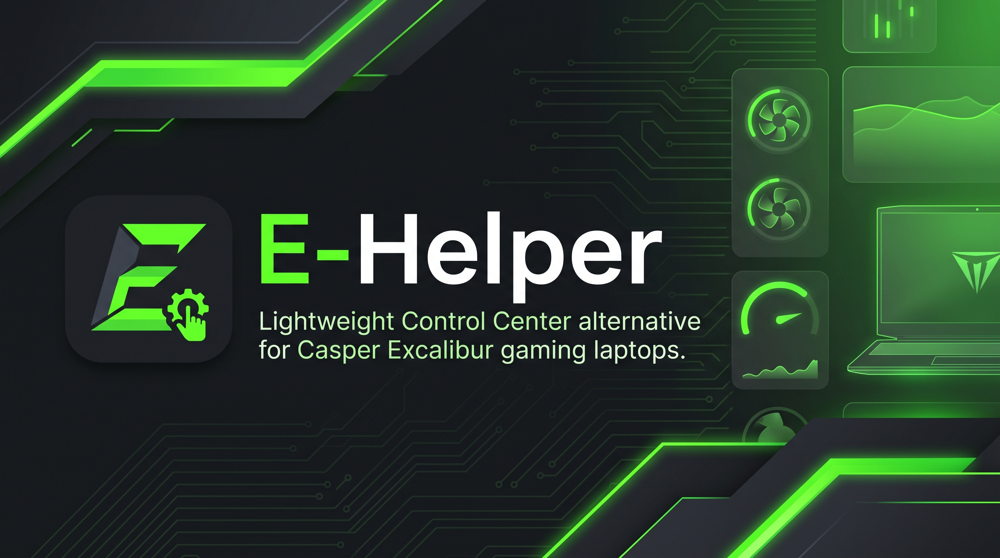

<p align="center">
  
</p>

<h1 align="center">E-Helper</h1>

<p align="center">
  <b>Casper Excalibur oyun laptopları için hafif ve açık kaynaklı kontrol merkezi.</b><br>
  Güç modları, canlı donanım verileri, RGB klavye aydınlatması ve uygulamaya özel profiller tek bir taşınabilir exe dosyasında.
</p>

<p align="center">
  <a href="https://github.com/berkevnl/E-Helper/releases/latest"></a>
  <a href="https://github.com/berkevnl/E-Helper/releases"></a>
  <a href="https://dotnet.microsoft.com/download/dotnet/8.0"></a>
  
  <a href="LICENSE"></a>
</p>

<p align="center">
  <a href="README.md">English</a> ·
  <a href="https://github.com/berkevnl/E-Helper/releases/latest">İndir</a> ·
  <a href="#özellikler">Özellikler</a> ·
  <a href="#uyumluluk">Uyumluluk</a> ·
  <a href="#kaynak-koddan-derleme">Derleme</a>
</p>

---

## Genel Bakış

**E-Helper**, üreticinin *Excalibur Control Center* yazılımının yerini alan küçük, hızlı ve gizliliğe saygılı bir araçtır. Laptopun gömülü denetleyicisiyle (EC) doğrudan ACPI WMI üzerinden, NVIDIA ekran kartıyla ise NVML üzerinden haberleşir. Arka plan servisi, telemetri ya da kurulum gerektirmez.

[G-Helper](https://github.com/seerge/g-helper)'dan ilham alan E-Helper, sistem tepsisinde çalışır ve tek tıkla kompakt bir kontrol paneli açar.

<p align="center">
  <a href="https://github.com/berkevnl/E-Helper/releases/latest">
    
  </a>
  <br>
  <sub>Taşınabilir: arşivden çıkarın ve çalıştırın. Kurulum veya ayrıca .NET yüklemek gerekmez.</sub>
</p>

## Öne Çıkanlar

| | Üretici Control Center | E-Helper |
| :--- | :--- | :--- |
| **Bellek kullanımı** | Yüzlerce MB | Tepside ~5–10 MB · panel açıkken ~30–50 MB |
| **Arka plan servisleri** | Birden fazla sürekli servis | Yok |
| **Telemetri / analiz** | Açık | Yok, tamamen yerel |
| **Kurulum** | Kurulum sihirbazı + sürücüler | Tek taşınabilir exe |
| **Panel açılış süresi** | Saniyeler | Anında |
| **Yeniden başlatma sonrası ayarlar** | Sıfırlanabilir | Oturum açıldıktan sonra otomatik uygulanır |
| **Güncellemeler** | Elle indirme | Uygulama içinden tek tık |

## Özellikler

### Güç modları
- **Tasarruf**, **Dengeli** ve **Performans** modları doğrudan EC'ye yazılır.
- Her mod, ilgili Windows güç planını da (Güç tasarrufu / Dengeli / Yüksek performans) etkinleştirir.

### Canlı donanım verileri
- İşlemci ve ekran kartı sıcaklığı, fan hızı (RPM) ve kullanım oranı.
- NVIDIA ekran kartı sıcaklığı sürücüden **NVML** ile okunur; EC sensöründen daha doğrudur.
- RAM ve sistem diski (C:) kullanımı.
- Tepsi simgesinin üzerine gelince paneli açmadan CPU/GPU sıcaklığı ve fan hızı görünür.

### RGB klavye aydınlatması
| Mod | Açıklama |
| :--- | :--- |
| **Sabit** | Tüm klavyede tek renk |
| **Nefes** | Donanım tabanlı nefes efekti |
| **Dinamik** | Donanım tabanlı renk döngüsü |
| **Spektrum** | Tüm tuşlarda eş zamanlı, akıcı renk geçişi |
| **Gökkuşağı** | Soldan sağa akan gökkuşağı dalgası |
| **3-Bölge** | Sol, orta ve sağ bölgeye ayrı renk |

- Parlaklık: **Kapalı / %50 / %100**.
- Spektrum ve Gökkuşağı için animasyon hızı: **Yavaş / Orta / Hızlı**.
- HSV paleti, HEX girişi ve hazır renklerle renk seçici; seçilen renk klavyede anında önizlenir.
- **Uyku zamanlayıcısı:** 15 sn, 30 sn, 45 sn, 60 sn veya 5 dk işlem yapılmadığında klavye ışığını kapatır; klavye, fare ya da touchpad hareketinde son ayarlarla geri açar.

### Uygulama profilleri
- Herhangi bir oyun veya uygulamaya (`.exe`) güç modu ve aydınlatma ayarı bağlayın.
- Uygulama kullanılırken profil otomatik uygulanır, kapandığında kendi ayarlarınıza geri dönülür.
- Uygulamayı çalışan işlemler listesinden seçebilir ya da exe dosyasına göz atabilirsiniz.

### Arayüz
- Koyu ve açık tema, 8 farklı vurgu rengi.
- Türkçe ve İngilizce; yeniden başlatmadan anında değişir.
- İsteğe bağlı Windows ile başlatma (Görev Zamanlayıcı ile; oturum açılışında UAC sorusu çıkmaz).
- Açılışta otomatik güncelleme kontrolü; tek tıkla indirir, değiştirir ve yeniden başlatır.

## Uyumluluk

E-Helper, Quanta ACPI/WMI EC arayüzünü kullanan **Casper Excalibur** laptoplar için geliştirilmiştir.

**Donanımda test edilenler:** G770 · G850 / G860 · G870 · G911

**Çalışması beklenenler (aynı EC arayüzü):** G780 · G900 · G920

> [!NOTE]
> Desteklenmeyen cihazlarda E-Helper **simülasyon modunda** açılır ve donanıma hiçbir komut göndermez.

**Gereksinimler:** Windows 10 veya 11 (64-bit) ve yönetici izni (Windows, ACPI WMI erişimi için bunu zorunlu tutar). NVIDIA ekran kartı isteğe bağlıdır; GPU sıcaklığı ve kullanımı için kullanılır.

## Hızlı Başlangıç

1. **[Son sürüm](https://github.com/berkevnl/E-Helper/releases/latest)** sayfasından `E-Helper-vX.Y.Z-win-x64.zip` dosyasını indirin.
2. Kalıcı bir klasöre çıkarın, örneğin `C:\Tools\E-Helper`.
3. `E-Helper.exe` dosyasını yönetici olarak çalıştırın.
4. E-Helper saatin yanındaki sistem tepsisine yerleşir. Paneli açmak için simgeye tıklayın.
5. İsterseniz **Ayarlar** bölümünden **Başlangıçta Çalıştır** seçeneğini açın.

Ayarlar `%LOCALAPPDATA%\E-Helper\config.json` dosyasında saklanır.

> [!TIP]
> Release sayfasında sıkıştırılmamış `E-Helper.exe` (~156 MB) da bulunur. ZIP paketi (~64 MB) aynı uygulamayı içerir ve daha hızlı iner.

## Nasıl Çalışır

```
┌──────────────────────────────────────────────────────────────┐
│                 E-Helper  (WPF · .NET 8)                     │
│   Tepsi paneli · Ayarlar · Profil izleyici · Güncelleyici    │
└───────────────┬───────────────────────────────┬──────────────┘
                │ ACPI WMI (root\WMI)           │ NVML
                ▼                               ▼
     ┌──────────────────────┐        ┌──────────────────────┐
     │  Casper / Quanta EC  │        │  NVIDIA GPU sürücüsü │
     │  güç · fan · RGB     │        │  sıcaklık · fan · %  │
     └──────────────────────┘        └──────────────────────┘
```

- **EC köprüsü:** komutlar `RW_GMWMI` WMI sınıfı üzerinden `SMI_STRUCT_S` paketleri olarak gönderilir.
  - `0xFA00` okuma · `0xFB00` yazma
  - Alt fonksiyonlar: `0x0100` LED · `0x0200` CPU/GPU verileri · `0x0205` fan hızı · `0x0206` fan kontrolü · `0x0300` güç modu
- **NVML:** `nvml.dll` çalışma anında yüklenir. NVIDIA sürücüsü yoksa GPU değerleri atlanır.
- **Başlangıç:** `HighestAvailable` yetkili bir zamanlanmış görev E-Helper'ı oturum açılışında başlatır. EC açılış sırasında durumunu sıfırlayabildiği için kayıtlı ayarlar kısa bir süre sonra yeniden uygulanır.
- **Bellek:** panel gizlendiğinde çalışma belleği küçültülür, böylece tepsideki bellek kullanımı düşük kalır.
- **Gizlilik:** uygulamanın yaptığı tek ağ isteği GitHub Releases API'sine yapılan güncelleme kontrolüdür.

## Kaynak Koddan Derleme

**Gereksinimler:** Windows 10/11 x64, [.NET 8 SDK](https://dotnet.microsoft.com/download/dotnet/8.0) veya üzeri.

```powershell
git clone https://github.com/berkevnl/E-Helper.git
cd E-Helper

# Release derlemesi
dotnet build src/EHelper/EHelper.csproj -c Release

# Bağımsız tek dosya derleme + release ZIP (çıktı: publish-standalone\)
powershell -ExecutionPolicy Bypass -File scripts/build-and-sign.ps1 -SkipSign
```

Uygulama sürümü yalnızca `src/EHelper/EHelper.csproj` dosyasında tanımlıdır.

### Proje yapısı

```
src/EHelper/
├── Core/          Temel tipler: güç/LED enum'ları, IHardwareProvider, AppProfile, donanım algılama
├── Hardware/
│   ├── Casper/      ACPI WMI üzerinden EC köprüsü, SMI paket yapısı, Windows güç planları
│   ├── Common/      NVIDIA NVML entegrasyonu
│   └── Simulation/  Desteklenmeyen cihazlarda kullanılan simülasyon sağlayıcısı
├── Services/      Telemetri, profil izleyici, klavye uyku zamanlayıcısı, güncelleyici,
│                  başlangıç görevi, dil desteği, bellek optimizasyonu
├── Config/        Ayar modeli ve config.json kaydı
├── UI/            Ayarlar, profil düzenleyici, renk seçici, tepsi simgesi, tema yardımcıları
├── MainWindow.*   Tepsi kontrol paneli
└── App.*          Başlatma, tek örnek kontrolü, servislerin bağlanması
scripts/build-and-sign.ps1   Bağımsız ve framework'e bağlı exe'leri ve release ZIP'ini üretir
```

## Katkıda Bulunma

Hata bildirimleri ve pull request'ler memnuniyetle karşılanır. Donanımla ilgili bir sorun bildirirken lütfen tam Excalibur modelinizi ve BIOS sürümünüzü belirtin.

## Teşekkür

**[G-Helper](https://github.com/seerge/g-helper)** ve geliştiricisi [Seerge](https://github.com/seerge)'den ilham alınmıştır.

## Lisans ve Sorumluluk Reddi

**[GNU GPL v3.0](LICENSE)** lisansı ile, hiçbir garanti verilmeksizin dağıtılır.

E-Helper bağımsız bir topluluk projesidir; Casper Bilgisayar Sistemleri A.Ş. ile bir bağlantısı yoktur ve onun tarafından desteklenmemektedir. *Casper*, *Excalibur*, *Windows* ve *NVIDIA* ilgili sahiplerinin ticari markalarıdır ve yalnızca uyumluluğu belirtmek için kullanılmıştır.
