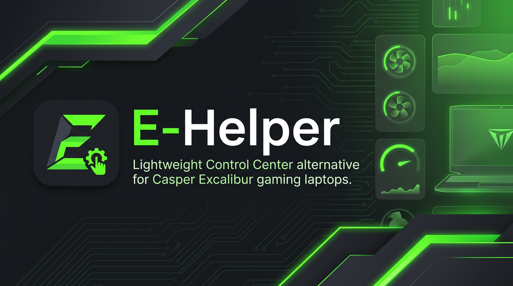

<p align="center">
  
</p>

# E-Helper — Casper Excalibur Kontrol Merkezi

<p align="center">
  <a href="https://github.com/berkevnl/E-Helper/releases"></a>
  <a href="https://github.com/berkevnl/E-Helper/releases/latest/download/E-Helper.exe"></a>
  <a href="https://github.com/berkevnl/E-Helper/blob/main/LICENSE"></a>
  <a href="#-neden-e-helper-temel-avantajlar"></a>
  <a href="https://dotnet.microsoft.com/download/dotnet/8.0"></a>
  <a href="README.md"></a>
</p>

---

**E-Helper**, **Casper Excalibur** serisi oyuncu dizüstü bilgisayarları için üreticinin yüksek kaynak tüketen, kararsız ve hantal kontrol yazılımlarına (*Excalibur Control Center*) alternatif olarak sıfırdan geliştirilmiş, açık kaynaklı ve ultra hafif bir donanım yönetim merkezidir.

ASUS ekosisteminde devrim yaratan **G-Helper** felsefesi temel alınarak tasarlanan E-Helper; hiçbir arka plan servisi kurmadan, telemetri takipçisi barındırmadan ve sistemi yormadan doğrudan anakartın gömülü denetleyicisi (EC) ve ACPI/WMI alt sistemiyle haberleşir.

<p align="center">
  <a href="https://github.com/berkevnl/E-Helper/releases/latest/download/E-Helper.exe">
    
  </a>
  <br>
  <sub><i>Tek dosya taşınabilir uygulama — Kurulum gerektirmez. Detaylı sürüm notları ve standalone ZIP paketleri için <a href="https://github.com/berkevnl/E-Helper/releases/latest">Releases (Sürümler)</a> sayfasını ziyaret edebilirsiniz.</i></sub>
</p>

---

## 📊 Orijinal Control Center ile E-Helper Karşılaştırması

| Özellik / Kriter | Orijinal Üretici Yazılımı | E-Helper (v1.2.0) |
| :--- | :---: | :---: |
| **RAM Tüketimi (Tepside / Boşta)** | 200 MB – 450 MB | **~1 MB – 5 MB** |
| **RAM Tüketimi (Pencere Açıkken)** | 350 MB – 600 MB | **~15 MB – 30 MB** (Otomatik bellek temizleme) |
| **Arka Plan Servisleri (Daemons)** | 4 – 8 sürekli çalışan servis | **0 (Sıfır arka plan servisi)** |
| **Telemetri ve Veri Toplama** | Arka planda telemetri takibi | **0 (Tamamen yerel, sıfır takip)** |
| **Açılış Tepki Süresi** | 3 – 8 saniye (hantal web/hibrit motor) | **Anında (< 100 ms açılış)** |
| **Kurulum Gereksinimi** | Çok adımlı yükleyici, kayıt defteri yükü | **Tek dosya `.exe` (Kurulumsuz / Portable)** |
| **Yeniden Başlatmada Ayar Korunumu** | Sık sık RGB ve fan ayarlarını sıfırlar | **%100 kararlı açılış sonrası eşitleme** |
| **Donanım İletişimi** | Aracı servis katmanları üzerinden | **Doğrudan ACPI WMI SMI ve NVIDIA NVML** |
| **Klavye Aydınlatma Denetimi** | Temel OEM modları | **3-Bölge Özel, Döngü (70 FPS), Dalga, Hız Barı** |
| **Otomatik Güncelleyici** | Manuel dosya indirme zorunluluğu | **Tek tıkla dikişsiz indirme ve yeniden başlatma** |

---

## ⚡ Neden E-Helper? (Temel Avantajlar)

1. **Casper Excalibur Donanımına Özel:** Sadece Casper Excalibur dizüstü bilgisayarlarının anakart ve Quanta EC mimarisine odaklanmıştır; gereksiz kod ve karmaşıklık içermez.
2. **Mikroskobik Kaynak Kullanımı:** Sistem tepsisinde beklerken yalnızca **~1 – 5 MB RAM** harcar. Ekranda aktif açıkken dahi otomatik çalışan kümeleme optimizasyonu (*TrimMemory*) ile bellek kullanımı **~15 – 30 MB** seviyesinde sabit tutulur.
3. **Sıfır Arka Plan Yükü (Bloat-Free):** Arka planda çalışan hizmetler (services), telemetri takipçileri, analitik ajanları ve CPU'yu meşgul eden gereksiz süreçler barındırmaz.
4. **Kalıcı Ayar Korunumu:** Güç profili, klavye aydınlatma modu, parlaklık seviyesi ve 3 bölge renkleri; bilgisayar kapatılıp açıldığında dahi kaybolmaz. Windows Görev Zamanlayıcısı başlangıç entegrasyonu ve açılış sonrası gecikmeli EC senkronizasyonu ile otomatik korunur.
5. **Doğrudan Donanım Köprüsü:** Üreticinin hantal servisleri yerine doğrudan anakart gömülü denetleyicisiyle (`0xFA00` Okuma / `0xFB00` Yazma SMI) ve NVIDIA NVML ile yerel iletişim kurar.
6. **Kompakt Sistem Tepsisi Paneli:** Görev çubuğunda kalabalık yapmaz, bildirim alanındaki simgesine tıklandığında ekranın köşesinden fırlayan modern bir arayüz açılır ve istendiğinde ekranda serbestçe taşınabilir.
7. **Çift Dil & Çift Tema:** Tek tıkla Türkçe ve İngilizce, ayrıca G-Helper esintili Mat Koyu ve Ferah Açık tema desteği.

---

## 🎯 Özellikler ve Yetenekler

### 1. ⚡ Güç ve Performans Modları
* **Tasarruf (Eco / Office):** Düşük fan devri, sessiz çalışma ortamı ve pil/enerji tasarrufu.
* **Dengeli (Balanced / Gaming):** Dinamik fan eğrisi ve dengeli termal yönetim.
* **Performans (Turbo / Performance):** Maksimum fan devri, genişletilmiş termal alan ve en yüksek donanım gücü.
* *Windows yerel güç planlarıyla (`PowerSetActiveScheme`) otomatik senkronize çalışır.*

### 2. 📊 Canlı Donanım Telemetrisi
* **Sıcaklık ve Fan Göstergeleri:** Gerçek zamanlı işlemci sıcaklığı (°C) ve takometre fan devirleri (RPM).
* **Güvenilir GPU Telemetrisi:** Harici ekran kartının gerçek çekirdek sıcaklığı ve fan devirleri, hatalı veya sabit değerli anakart sensörleri yerine doğrudan **NVIDIA NVML** sürücüsünden okunur.
* **Sistem Kaynakları İzleme:** Canlı RAM kullanımı (GB ve yüzde) ve sistem diski SSD (C:) doluluk oranı.
* **Sistem Tepsisi İpucu (Tooltip):** Fare tepsi simgesinin üzerine getirildiğinde pencereyi açmaya gerek kalmadan anlık CPU/GPU sıcaklıkları ve fan RPM bilgileri görüntülenir.

### 3. 🌈 RGB Klavye Aydınlatma Motoru
* **6 Farklı Aydınlatma Modu:**
  * **Sabit (Static):** Tüm klavyede tek bir sabit renk.
  * **Nefes (Breathing):** Anakart donanım seviyesinde doğal, ışığı sıfır karanlığa kadar söndürüp geri getiren yumuşak soluk alma döngüsü.
  * **Dinamik (Colorful Dynamic Cycle):** Donanımsal sürekli renk değişimi.
  * **Döngü (Synchronized Spectrum Cycle):** Yüksek yenileme hızlı (~70 FPS), tüm tuşların aynı anda aynı rengi alarak spektrumdaki tüm renk tonları arasında kesintisiz, akıcı ve yanıp sönmesiz dolaştığı senkronize mod.
  * **Gökkuşağı (Rainbow Wave):** Soldan sağa doğru (WASD → Orta → Numpad) akıcı şekilde ilerleyen çok bölgeli spektrum dalgası.
  * **3-Bölge (3-Zone Custom RGB):** Klavyenin 3 bağımsız bölgesine ayrı ayrı renk tanımlayabilme.
* **İnteraktif 2D 3-Bölge Haritası:** Kuşbakışı 2D 3 parçalı klavye şematiği ile Sol (WASD), Orta ve Sağ (Numpad) alanlarına doğrudan renk atayabilme.
* **Dinamik 3 Kademeli Hız Barı:** Döngü ve Gökkuşağı modlarında animasyon hızını (**Yavaş**, **Orta**, **Hızlı**) anında ayarlayabilme; seçili hızın başlıkta canlı gösterimi (`Parlaklık: %100 - Hızlı`).
* **Windows 11 Tarzı Renk Seçici:** 2D HSV renk alanı, 1D ton kaydırıcısı, Hex kodu girişi, RGB değerleri ve hazır renk kartelasıyla zengin renk paleti.
* **Donanımsal Parlaklık Kademeleri:**
  * `0` : **Kapalı (%0)** — Klavye LED güç hattını donanımsal olarak kapatır.
  * `1` : **%50 Parlaklık** — Dengeli ortam parlaklığı.
  * `2` : **%100 Parlaklık** — Tam parlaklık seviyesi.
  * *Kaydırıcı çubuğun istenen noktasına tıklanarak doğrudan ayarlanabilir.*
* **Yeniden Başlatmada Korunum:** Bilgisayar yeniden başlatıldığında klavye aydınlatma modunuz, parlaklığınız, hızınız ve bölge renkleriniz otomatik olarak tekrar uygulanır.

### 4. 🎨 Arayüz ve Görsel Ergonomi
* **Modern Tipografi:** Google Sans ve modern sistem yazı tipleri; ClearType ve Display alt piksel işleme modları ile tüm ekranlarda jilet gibi keskin metinler.
* **%100 Vektörel İkonlar:** Kırpılma veya bozulma yaşamayan yüksek kaliteli vektörel ikonlar.
* **Tek Tıkla Tema Değişimi:** Mat Koyu ve Ferah Açık tema seçenekleri.
* **Akıcı Mikro Etkileşimler:** Yumuşak geçiş animasyonları ve sistem kaynaklarını kilitlemeyen asenkron yapı.

### 5. 🔄 Dikişsiz Otomatik Güncelleyici
* **Sessiz Arka Plan Kontrolü:** E-Helper her açılışta arka planda GitHub Releases üzerinden en güncel sürümü kontrol eder; açılış hızını asla etkilemez (0 ms gecikme).
* **Etkileşimli Sürüm Durumu:** Sol alt köşede durum bilgisi (Uygulama güncelse gri `Sürüm: 1.2.0`, güncelleme varsa kırmızı `İndir: 1.1.1 → 1.2.0`).
* **Tek Tıkla Otomatik Güncelleme:** Güncelleme metnine tıklandığında son sürüm paketi arka planda otomatik indirilir, açık olan uygulama kapatılır, dosya yenilenir ve yeni sürüm anında başlatılır.

---

## 💻 Donanım Uyumluluğu

E-Helper özel olarak **Casper Excalibur** ailesi için tasarlanmıştır:

### ✅ Fiziksel Donanımda Doğrulanan Modeller
> Test edilmiş ve tüm özellikleriyle (güç modları, telemetri, fan bilgisi, RGB aydınlatma) çalıştığı onaylanmıştır:
* **Excalibur G770** (Test Edildi & Doğrulandı)
* **Excalibur G850 / G860** (Test Edildi & Doğrulandı)
* **Excalibur G870** (Test Edildi & Doğrulandı)
* **Excalibur G911** (Test Edildi & Doğrulandı)

### 🔍 Mimari Uyumluluğu
Quanta ACPI/WMI Gömülü Denetleyici (EC) altyapısını kullanan Casper Excalibur modelleriyle uyumludur:
* **Excalibur G780**
* **Excalibur G900**
* **Excalibur G920**

---

## 🔬 Çalışma Mantığı (Arka Planda Neler Oluyor?)

```
┌────────────────────────────────────────────────────────┐
│                   E-Helper (WPF / .NET 8)              │
│       Flyout UI  •  Sistem Tepsisi  •  Ayar Yöneticisi │
└───────────┬────────────────────────────────┬───────────┘
            │                                │
            ▼ (ACPI WMI SMI)                 ▼ (NVIDIA NVML)
┌────────────────────────┐      ┌────────────────────────┐
│  Casper / Quanta EC    │      │  NVIDIA Harici GPU     │
│  - Güç Profilleri      │      │  - Gerçek Çekirdek Isı │
│  - Fan Devirleri (RPM) │      │  - Harici Fan Devri    │
│  - RGB Klavye Hatları  │      └────────────────────────┘
└────────────────────────┘
```

1. **WMI ACPI SMI Köprüsü:** Anakart üzerindeki gömülü kontrolcüyle `ROOT\WMI` isim alanı üzerinden doğrudan haberleşir. Komutlar standart `SMI_STRUCT_S` yapısına paketlenir:
   * `0xFA00`: Okuma Komutu (sıcaklık ve fan devirleri)
   * `0xFB00`: Yazma Komutu (performans modları, fan hızı ve LED paketleri)
   * Alt fonksiyonlar: `0x0100` (LED), `0x0200` (CPU/GPU), `0x0205` (Fan Hızı), `0x0300` (Güç Modu).
2. **NVML Doğrudan Bağlantısı:** `nvml.dll` üzerinden doğrudan NVIDIA GeForce RTX/GTX ekran kartı sürücüsüne bağlanır; anakarttaki kalibre edilmemiş sensörleri atlayarak en doğru sıcaklık verisini alır.
3. **Yetkilendirilmiş Başlangıç Görevi:** Windows Görev Zamanlayıcısı üzerinde en yüksek yetkiyle (`HighestAvailable`) bir görev oluşturur; böylece Windows açılışında UAC (Kullanıcı Hesabı Denetimi) penceresi çıkarmadan sessizce tepside başlar.

---

## 🚀 İndirme ve Kullanım

1. [Releases (Sürümler)](https://github.com/berkevnl/E-Helper/releases/latest) sayfasına gidin.
2. **`E-Helper.exe`** dosyasını (kurulum gerektirmeyen tek parça taşınabilir dosya, ~156 MB, gömülü .NET çalışma zamanı içerir) veya **`E-Helper-v1.2.0-win-x64.zip`** arşivini indirin.
3. `E-Helper.exe` dosyasına sağ tıklayıp **Yönetici Olarak Çalıştır** deyin *(Windows'un ACPI WMI SMI donanım kontrolcüsüne erişebilmesi için yönetici yetkisi şarttır)*.
4. E-Helper ekranın sağ altındaki **Sistem Tepsisine** (saatin yanına) yerleşecektir. Simgeye tıklayarak paneli açıp kapatabilirsiniz!
5. *(İsteğe Bağlı)* Bilgisayar her açıldığında otomatik başlaması için uygulama içindeki **Başlangıçta Çalıştır** kutucuğunu işaretleyin.

---

## 🛠️ Kaynak Koddan Derleme

### Gereksinimler
* Windows 10 / 11 (64-bit)
* [.NET 8.0 SDK](https://dotnet.microsoft.com/download/dotnet/8.0) veya üzeri
* Visual Studio 2022 (*.NET Masaüstü Geliştirme* iş yükü ile) veya VS Code / JetBrains Rider

### Derleme Adımları
```powershell
# Repoyu klonlayın
git clone https://github.com/berkevnl/e-helper.git
cd e-helper

# Bağımlılıkları geri yükleyin ve derleyin
dotnet build src/EHelper/EHelper.csproj -c Release

# Veya tüm standalone paketleri derleyip imzalamak için:
powershell -ExecutionPolicy Bypass -File scripts/build-and-sign.ps1
```

Derlenen tek dosya bağımsız çalıştırılabilir uygulama `publish-standalone\E-Helper.exe` dizininde oluşacaktır.

---

## 💖 Teşekkür & İlham Kaynağı

Bu proje, **[Seerge](https://github.com/seerge)** tarafından geliştirilen öncü **[G-Helper](https://github.com/seerge/g-helper)** projesinden ilham almıştır. E-Helper, bu hafif, sade ve saygılı yazılım felsefesini doğrudan Casper Excalibur kullanıcılarına sunmayı hedefler.

---

## ⚖️ Yasal Haklar ve Sorumluluk Reddi

* Bu projede adı geçen tüm ürün adları, logolar ve markalar (*Casper*, *Excalibur*, *Windows*, *NVIDIA*) ilgili hak sahiplerinin mülkiyetindedir ve yalnızca donanım uyumluluğunu belirtmek amacıyla kullanılmıştır.
* **E-Helper**, bağımsız ve açık kaynaklı bir topluluk projesidir; Casper Bilgisayar Sistemleri A.Ş. ile herhangi bir resmi bağı veya ortaklığı yoktur.
* Bu yazılım **GNU General Public License v3.0 (GPL-3.0)** lisansı altında, hiçbir garanti verilmeksizin "olduğu gibi" sunulmaktadır.
